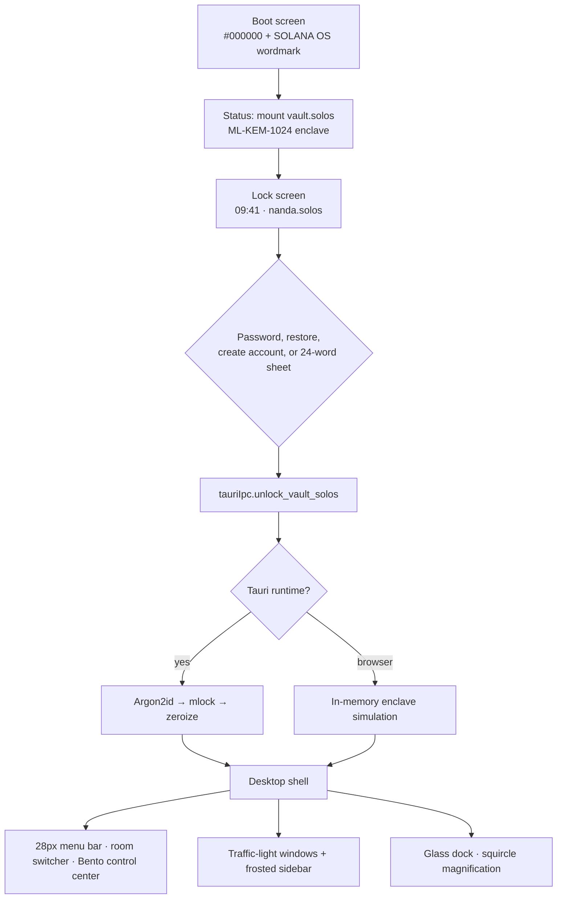
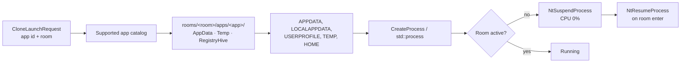
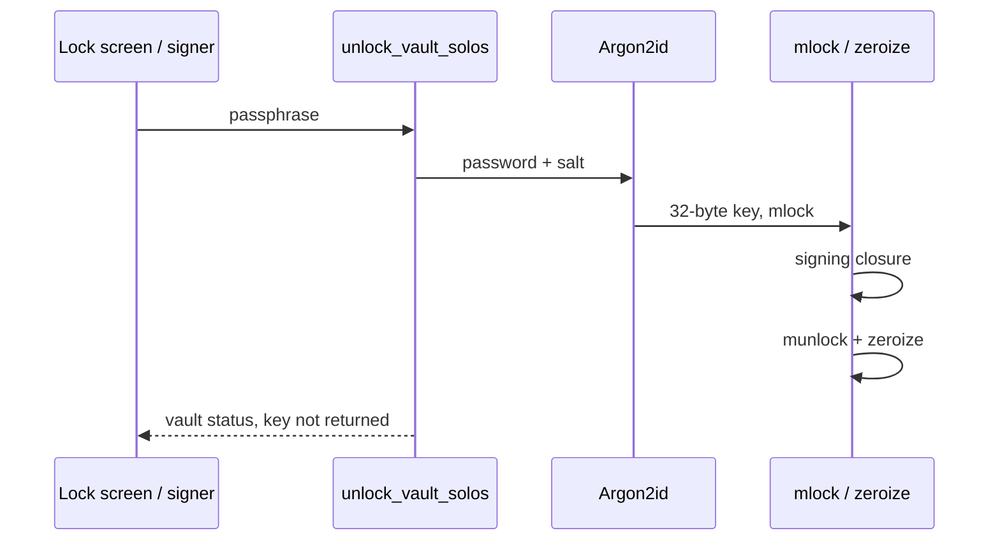
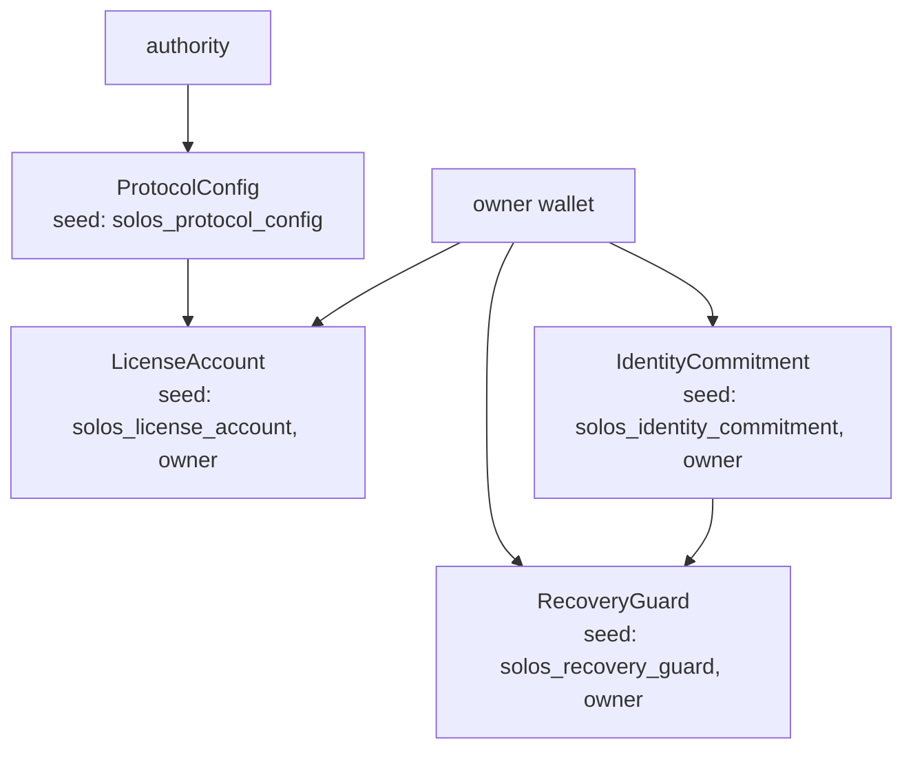

# Solana OS Architecture

This document describes the desktop shell, the Tauri host, the `vault.solos` container, and the `solana-os-registry` program as they exist in this tree. Where a cryptographic construction is reserved rather than implemented, the text says so.

## Startup flow



`src/App.tsx` renders exactly one of boot, lock, or desktop. `Ctrl/Cmd+L` returns to the lock screen. `Ctrl/Cmd+Space` opens Spotlight, which launches a window or switches a room.

The browser build does not hold a sealed container on disk. `src/lib/tauriIpc.ts` detects `window.__TAURI_INTERNALS__` and otherwise resolves the same commands locally so the shell can be reviewed without the host.

## Rooms

| Room | Accent | Role |
| --- | --- | --- |
| Main | `#14F195` | Primary vault. Freemium. |
| Degen | `#F43F5E` | Research desk. Shield defaults on. |
| Dev | `#38BDF8` | Anchor builder. Cursor clone starts frozen. |
| Burner | `#F59E0B` | Ephemeral session. Shred on lock. |

`switch_room` in the host freezes every clone in the room being left and resumes the room being entered. The React store mirrors that by opening the room's default window.

## Universal App Cloner



`UniversalAppCloner` (`src-tauri/src/cloner.rs`) never reinstalls the binary. It redirects the per-user profile:

- `AppData/Roaming`, `AppData/Local`, `Temp`, `UserProfile`
- `RegistryHive/registry_overrides.json` describing an HKCU overlay rooted at `HKCU\Software\SolanaOS\Rooms\<room>\Apps\<app>\HKCU_Root`

On Windows, launch uses the Win32 desktop and job APIs declared in `Cargo.toml`. On other hosts the same directory layout is created and the process is spawned with the overridden environment. `freezer.rs` calls `NtSuspendProcess` / `NtResumeProcess` through `windows-rs` on Windows and a POSIX suspend/resume path elsewhere.

`desktop.rs` tracks two desktops: the host default and `SolanaOS_Enclave_Desktop`. The emergency path returns the session to the host desktop.

Standalone wallet windows (Phantom, Solflare, Backpack) are shell windows bound to a room key. They are not Chromium extensions sharing the host profile.

## `vault.solos` binary layout

```mermaid
flowchart TB
  subgraph header["Header"]
    magic["magic SOLOS\\x01 · 6"]
    ver["version, kdf, aead, kem ids · 4"]
    salt["Argon2id salt · 16"]
    params["mem kib, time, lanes · u32 × 3"]
    nonce["XChaCha nonce · 24"]
  end
  subgraph body["Body"]
    kemlen["kem ciphertext length · u32"]
    kem["ML-KEM-1024 ciphertext slot<br/>0 or 1568 bytes"]
    ctlen["ciphertext length · u32"]
    ct["XChaCha20-Poly1305 ciphertext + tag"]
  end
  header --> body
```

| Field | Value in this tree |
| --- | --- |
| KDF id `1` | Argon2id (RFC 9106), interactive parameters 8 MiB, 2 iterations, 1 lane, 32-byte output |
| AEAD id `2` | XChaCha20-Poly1305 |
| KEM id `3` | ML-KEM-1024. Ciphertext slot is 1568 bytes. Encapsulation is supplied by the caller as a 32-byte shared secret |
| Signature suite | ML-DSA-87 sizes are reserved (`pk` 2592, `sig` 4627). A Dilithium implementation is not linked |

Key mix, when a shared secret is present:

```
AEAD key = SHA-256( Argon2id(password, salt) || kem_ss || "vault.solos/v1" )
```

Without a shared secret the AEAD key is the Argon2id output. A wrong password or a missing shared secret fails closed (`open` returns an error and does not return plaintext).

## Post-quantum key enclave



`with_signing_key` is the millisecond enclave. The derived key is pinned with `mlock` (Unix) for the closure and wiped with `zeroize` before the function returns. `VirtualLock` is the Windows counterpart of the same pattern; the Unix build uses `libc::mlock`. The UI never receives the raw key. `seal_vault_solos` / `open_vault_solos` are the IPC pair for a container blob.

What this module does **not** do: it does not run ML-KEM encapsulation or ML-DSA signing internally. Those sizes and the shared-secret combiner are the stable interface for a future decapsulator. Shipping a homemade lattice implementation would be worse than a narrow, tested AEAD.

## Anchor PDA layout

Program id: `G8bkBpvs8E76jygEgHy3Lj6ZaHXZFWsBwG51uciNfUt4`.



| Account | Stores | Does not store |
| --- | --- | --- |
| `ProtocolConfig` | Treasury, USDC mint, pass mint, Pro price, pause flag | Keys |
| `IdentityCommitment` | 32-byte commitment, ML-KEM/Poseidon root, anti-tamper root, nonce | Seed phrase, `id.json` |
| `RecoveryGuard` | Guardian root, enclave attestation hash, threshold, cooldown, pending owner | Guardian secrets |
| `LicenseAccount` | Tier, room bitmask, expiry, amount paid | Payment instrument secrets |

Room bitmask: bit 0 Main, bit 1 Degen, bit 2 Dev, bit 3 Burner. Freemium is `0b0001`. Pro and Lifetime Pass are `0b1111`.

`verify_commitment` and `rotate_commitment` check a domain-separated SHA-256:

```
witness = SHA-256( root || nonce_le || domain )
```

Domains are `solos-verify`, `solos-rotate`, and `solos-guardian`. This is a commitment check. It is not a Groth16 or STARK verifier. The zero-knowledge property comes from never writing the preimage on-chain.

`execute_recovery` requires `pending_approvals >= threshold` and `now >= initiated_at + cooldown` (cooldown at least 60 seconds). It then rewrites the commitment owner and hash.

`upgrade_license_sol` transfers `amount` lamports to the protocol treasury when `amount >= pro_price_lamports`, then sets the license to Pro for one year.

## Anti-drainer pipeline

```mermaid
flowchart TD
  origin["Origin URL"] --> phish["Homograph / typosquat check<br/>against known Solana domains"]
  ix["Instructions"] --> sim["simulate_and_verify_transaction"]
  phish --> sim
  sim --> setauth{"SetAuthority or<br/>unlimited approve?"}
  setauth -->|yes| block["CriticalBlock · do not sign"]
  setauth -->|no| score["Risk score + balance delta"]
  clip["Clipboard text"] --> click["ClickFix signature scan"]
  click -->|match| drop["Blocked payload"]
  win["Solana OS HWND"] --> affinity["SetWindowDisplayAffinity<br/>WDA_EXCLUDEFROMCAPTURE"]
```

`src-tauri/src/security/anti_drainer.rs` is the pipeline the shell calls through `inspect_url`, `simulate_transaction`, and `inspect_clipboard`.

- Phishing: host extraction, Levenshtein distance against a fixed list (Jupiter, Phantom, Raydium, Magic Eden, and others).
- Transactions: `SetAuthority`, unlimited delegate approvals, and unknown programs raise the score. A critical score is a block, not a warning the user can click through inside the shield.
- Clipboard: `inspect_clipboard_clickfix` flags command-injection lures. `isolation.rs` classifies clipboard contents per room and refuses to sync seed-class text to the host clipboard.
- Capture: on Windows, `SetWindowDisplayAffinity` with `WDA_EXCLUDEFROMCAPTURE` (`0x11`) keeps the window out of ordinary screen capture.

The wallet windows in the shell show the same idea as a pre-sign panel: origin, balance delta, and an explicit Sign / Reject. That panel is the user-facing half of the pipeline.

## IPC surface

| Command | Module |
| --- | --- |
| `unlock_vault_solos`, `lock_vault_solos`, `get_vault_status` | Enclave status |
| `seal_vault_solos`, `open_vault_solos` | `quantum_vault` |
| `switch_room` | Room key id + auto freeze |
| `clone_and_launch_app`, `list_room_instances`, `terminate_app_instance` | Cloner |
| `freeze_app_instance`, `resume_app_instance`, `freeze_room_apps`, `resume_room_apps` | Freezer |
| `switch_virtual_desktop`, `emergency_restore_windows_desktop` | Virtual desktop |
| `inspect_url`, `simulate_transaction`, `inspect_clipboard` | Shield |

Permissions for the webview are the Tauri v2 default capability (`src-tauri/capabilities/default.json`).
